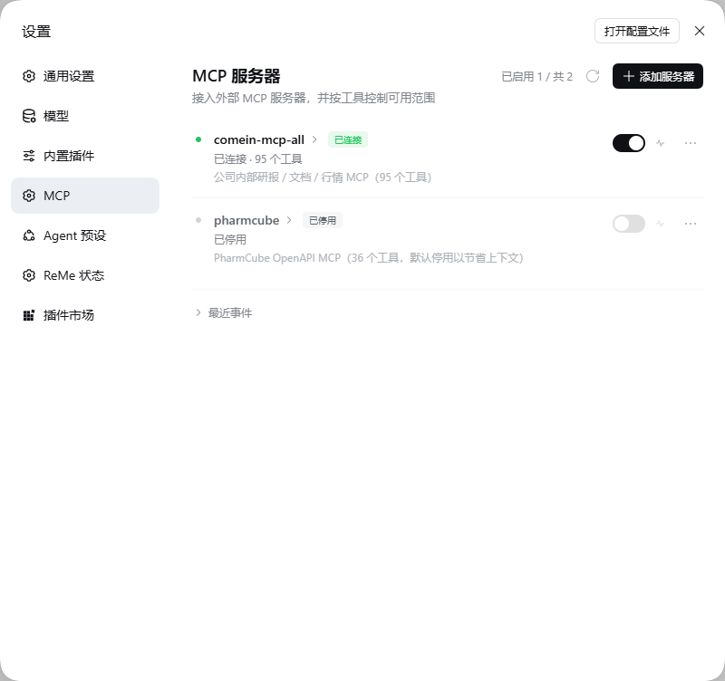
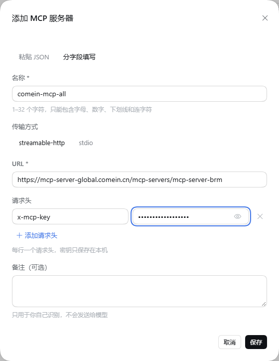
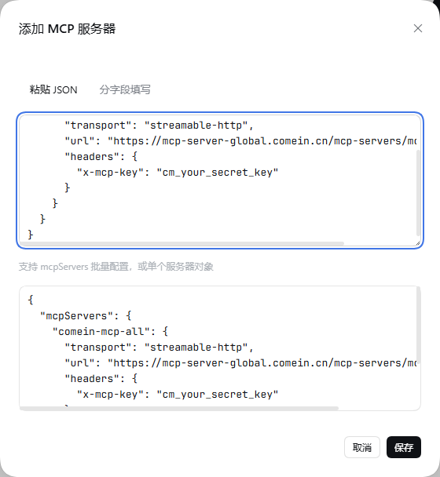
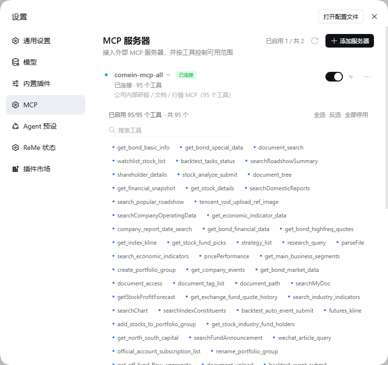
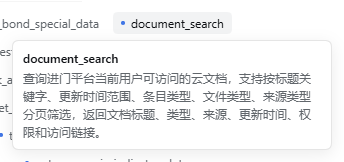
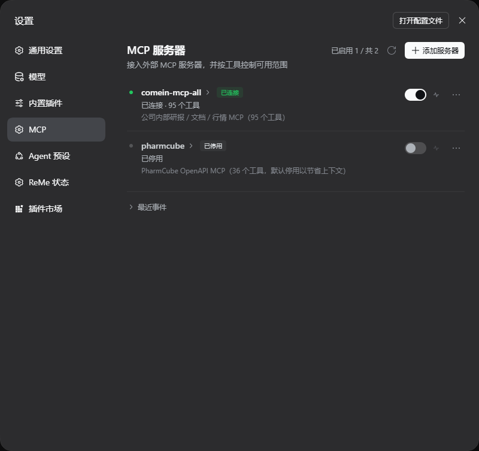
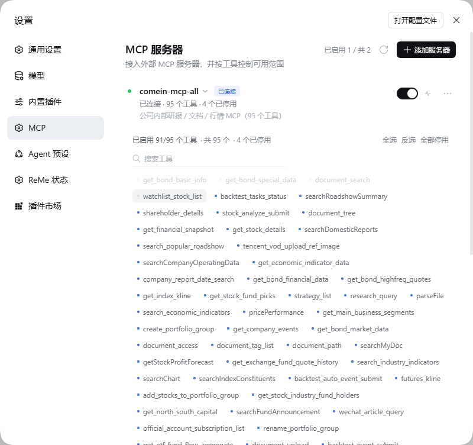

# dsh-mcp-tools

**DeepSeek Harness 最简洁、优雅的MCP工具管理器。**

[](https://www.npmjs.com/package/dsh-mcp-tools)
[](https://www.npmjs.com/package/dsh-mcp-tools)
[](LICENSE)
[](https://nodejs.org)

[English](README.en.md) | 简体中文

在 DeepSeek Harness Web GUI 的**设置**里管理外部 MCP 服务器：添加、粘贴密钥、测试连通性、逐工具开关。被停用的工具**不会注册进模型**，既不占上下文，也无法被误调用。



---

## 为什么做这个

MCP 很好用，直到某个「全家桶」服务器把 95 个工具塞进每一次请求。DSH 原生配置是 YAML/JSON 文件：改一次要重组 profile 甚至重启，而且没法表达「保留这个服务器，但只给模型 12 个工具」。

dsh-mcp-tools 把这些搬进了 **设置 → MCP**：

- 增删改停服务器，不碰配置文件；
- 请求头按 Postman 的方式一行一个键值对，密钥只留在本机；
- 启用前先验证连通性和工具数量；
- 按服务器逐工具开关，支持搜索、全选、反选、全部停用。

---

## 功能

### 服务器管理

- **两种传输**：`streamable-http`（URL + 请求头）与 `stdio`（命令、参数、环境变量、工作目录）。
- **两种录入**：分字段填写，或直接粘贴 `{"mcpServers": { ... }}`（与 DSH 原生配置同格式），一次导入多个服务器。
- **服务器开关**：关闭即断开连接并注销该服务器全部工具，不会删除配置。
- **复制配置**：一键复制该服务器的 `mcpServers` 片段。

### 像 Postman 一样填密钥

请求头是键值对行，而不是 JSON 文本框。新服务器默认带一行 `x-mcp-key`，把密钥粘进「值」即可保存。



值默认掩码显示，可逐行切换显示；名称重复会就地报错。也可以切到「粘贴 JSON」——解析后会把名称、URL、传输方式和请求头同步回表单。



### 真正的逐工具控制

每个工具是一个 chip。点击即停用，工具会立刻从模型工具列表中消失（不是注册了再报错）。支持搜索、全选、反选、全部停用。



悬停 chip 可查看完整描述，服务器停用时也能看。



### 连通性测试与事件日志

测试按钮会临时建连：`initialize` → `tools/list` → 关闭，回报耗时、协议版本与工具数量，不改动正在运行的服务器。下方「最近事件」记录连接、重载、测试与失败。

### 与 DSH 原生一致

沿用 `--dsw-*` 设计 token、平铺行、32px 输入框，深浅色与中英文自适应，键盘焦点环完整。客户端没有构建步骤：它是 classic script，只依赖 `react` 与官方 UI primitives。

深色模式：



停用部分工具：



---

## 安装

需要 **DeepSeek Harness 0.2.x**（Web GUI，`dsh web`）与 **Node.js ≥ 22.13**。

### 通过插件页安装（推荐）

1. 打开 DSH Web GUI → 侧边栏 **插件**。
2. 点击安装，填入 `dsh-mcp-tools`，确认。
3. 启用新 bundle，然后刷新一次页面。
4. 打开 **设置 → MCP**。

### 通过命令行安装

```bash
dsh plugin --profile web add dsh-mcp-tools
```

然后把 `"dsh-mcp-tools"` 加进 `~/.dsh/profiles/web/package.json` 的 `dsh.profile.bundles`（或在插件页启用该 bundle），刷新页面。若分区仍未出现，重启 `dsh web`。

> 升级包版本后需要重启 `dsh web`，才会加载新的 host 模块。

---

## 快速开始

1. **设置 → MCP → 添加服务器**。
2. 远程服务器：填 URL，把密钥粘贴进请求头行（默认 `x-mcp-key`）。
3. 点 **测试连接**，应看到类似 `已连接 · 95 个工具 · 478 ms`。
4. 保存，并打开服务器开关。
5. 在会话中直接让模型调用工具。DSH 会把它注册为 `mcp__<服务器>__<工具>`。

想省上下文，就展开工具列表，把用不到的停用。启用的工具越少，每次请求里的工具 schema 越小。

---

## 工作原理

```
DeepSeek Harness Web (dsh web)
├── Host 插件（lib/）              ← cordis bundle patch，复用原生 MCP 客户端
│   ├── manager.js                连接、工具注册、启停
│   ├── store.js                   ~/.dsh/dsh-mcp-tools/state.json（原子写、监听外部修改）
│   └── routes.js                  /mcp-tools/api/*
└── 客户端 bundle（client/client.js）
    └── 设置分区「MCP」（id: mcp，order: 18）—— classic script，无需构建
```

- Host 插件包装 DSH 原生 MCP 客户端，工具与会话的接入方式与手写配置完全一致（`mcp__服务器__工具`）。
- 启停生效于**注册时**而非调用时：停用的工具根本不出现在模型工具列表里。
- 状态在 `~/.dsh/dsh-mcp-tools/state.json`，原子写入；外部修改会被监听并热应用。

REST 接口（面板在用，也可脚本调用）：`GET /mcp-tools/api/state`、`POST /servers/{test,save,delete,toggle,refresh}`、`POST /tools/{toggle,bulk}`、`POST /import`、`POST /reload`、`GET /logs`。详见 [docs/API.md](docs/API.md)。

---

## 安全说明

- 服务器请求头以**明文**保存在本地状态文件里。文件只在本机，请不要提交到仓库或同步到公开位置。
- 给每个 MCP 服务器使用独立、最小权限的密钥。
- 插件除你配置的 MCP 服务器外不发起任何网络请求，没有遥测。
- 删除服务器后，它的工具会从后续所有请求中移除。

---

## 开发

```bash
git clone https://github.com/hxlog/dsh-mcp-tools.git
cd dsh-mcp-tools
node --check client/client.js
npm run selftest
```

调试时把源码目录链接进 profile，而不是安装副本（Windows 示例）：

```bat
rmdir "C:\Users\<你>\.dsh\profiles\web\node_modules\dsh-mcp-tools"
mklink /J "C:\Users\<你>\.dsh\profiles\web\node_modules\dsh-mcp-tools" "D:\path\to\dsh-mcp-tools"
```

- **客户端改动**：刷新页面。bundle 直接从磁盘提供，无构建。
- **Host 改动**：修改一次 profile 的 `cordis.patch.yml`（例如追加一行注释）触发 HMR 重组；日志出现 `MCP 管理器已启动` 即生效。

面板是单个 classic script，因为 DSH Web loader 以 classic script 方式执行客户端 bundle。只能 require `react` 与 `@deepseek-ai/dsh-client-ui-primitives`。

---

## 常见问题

**设置里没有 MCP 分区。** 多半是 bundle 未启用：去插件页确认并刷新页面，必要时重启 `dsh web`。

**会话里看不到工具。** 确认服务器开关已打开、对应工具 chip 也是启用状态；停用的工具不会被注册。

**测试连接失败。** 检查 URL、服务器是否使用 `streamable-http`（而非普通 SSE）、请求头名称是否与服务端要求一致；网络/代理问题也会在这里暴露。

**状态文件在哪？** `~/.dsh/dsh-mcp-tools/state.json`。删除即重置为空，下次启动会自动重建。

---

## License

[MIT](LICENSE)
