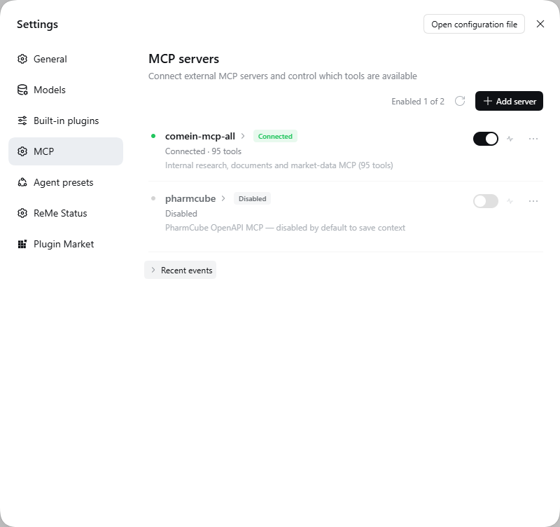
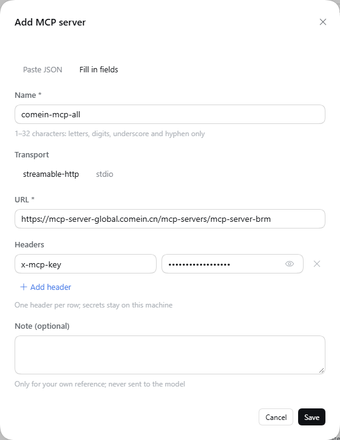
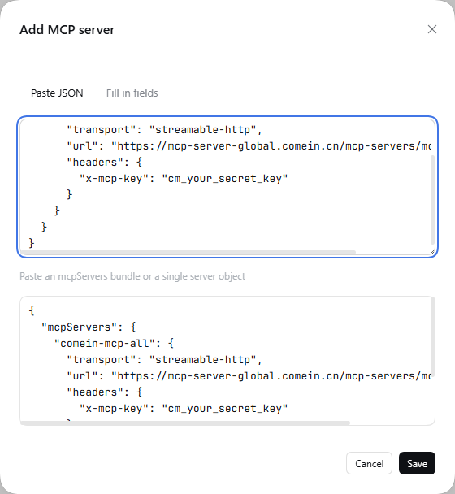
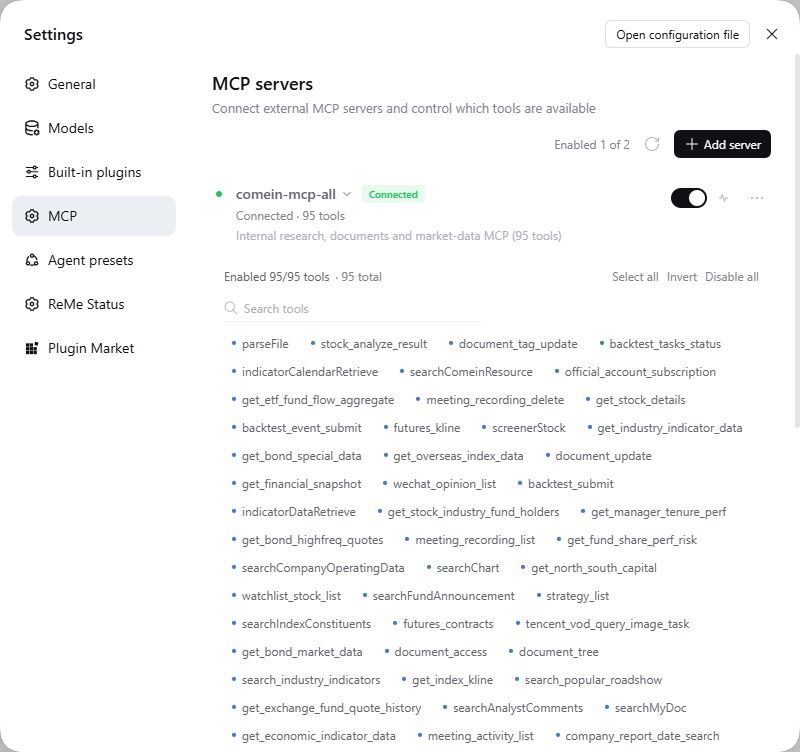
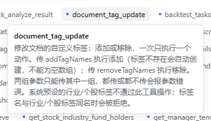
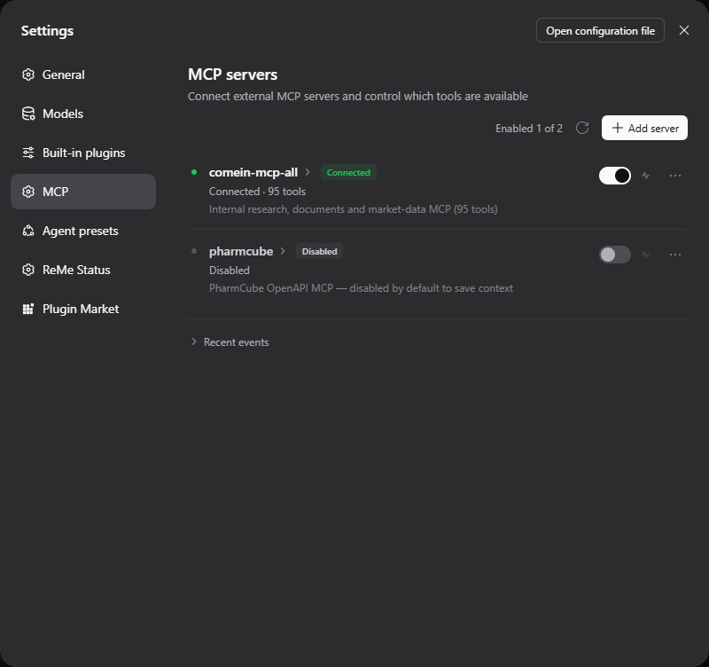
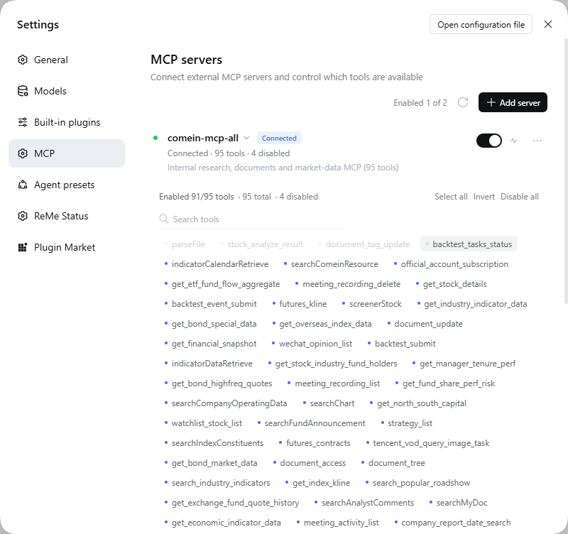

# dsh-mcp-workbench

**The most minimal, elegant MCP tool manager for DeepSeek Harness.**

[](https://www.npmjs.com/package/dsh-mcp-workbench)
[](https://www.npmjs.com/package/dsh-mcp-workbench)
[](LICENSE)
[](https://nodejs.org)

English | [简体中文](README.zh-CN.md)

A settings panel for external MCP servers, built into the DeepSeek Harness Web GUI. Add a server, paste the key, test the connection, and turn individual tools on or off — the disabled ones **never reach the model**, so they cost no context and cannot be called by mistake.



---

## Why this exists

MCP servers are great until a single "all-in-one" server drops 95 tools into every request. DSH's native configuration is a YAML/JSON file: editing it means restarting or recomposing the profile, and there is no way to say *"keep this server, but give the model only 12 of its tools."*

dsh-mcp-workbench moves all of that into **Settings → MCP**:

- add, edit, disable and delete servers without touching config files;
- paste secrets as Postman-style key/value headers (headers stay on your machine);
- verify connectivity and see the tool count before enabling anything;
- toggle tools per server, with search, select-all, invert and disable-all.

---

## Features

### Server management

- **Two transports**: `streamable-http` (URL + headers) and `stdio` (command, args, env, cwd).
- **Two ways to add**: fill in fields, or paste an `{"mcpServers": { ... }}` block — the same shape DSH and Claude Desktop use — to import several servers at once.
- **Server switch**: turning a server off disconnects it and unregisters all of its tools. Nothing is deleted.
- **Copy config**: one click copies that server back out as an `mcpServers` snippet.

### Secrets, the Postman way

Header rows are key/value pairs, not a JSON textarea. A new server starts with an `x-mcp-key` row: paste the secret into the value column and save.



Values are masked by default and can be revealed per row. Duplicate header names are rejected inline. Prefer JSON? Switch to **Paste JSON** — it syncs name, URL, transport and headers back into the form.



### Real per-tool control

Every tool is a chip. Click to disable; the tool disappears from the model's tool list immediately (it is not registered at all). Search, select all, invert, disable all.



Hover a chip for its full description, even while the server is disabled.



### Connectivity test and event log

The test button opens a throwaway connection: `initialize` → `tools/list` → close. It reports latency, protocol version and tool count, and never mutates the running server. A compact event log records connects, reloads, tests and failures.

### Native fit

Same design tokens (`--dsw-*`), same flat rows, same 32px inputs as DSH itself. Light and dark, Chinese and English, keyboard focus rings included. No build step: the client bundle is a classic script that only requires `react` and the official UI primitives.

See it in dark mode:





---

## Install

Requires **DeepSeek Harness 0.2.x** with the Web GUI (`dsh web`) and **Node.js ≥ 22.13**.

### From the Plugins page (recommended)

1. Open the DSH Web GUI → **Plugins** in the sidebar.
2. Choose **Install**, enter `dsh-mcp-workbench`, and confirm.
3. Enable the new bundle, then refresh the page once.
4. Open **Settings → MCP**.

### From the CLI

```bash
dsh plugin --profile web add dsh-mcp-workbench
```

Then add `"dsh-mcp-workbench"` to `dsh.profile.bundles` in `~/.dsh/profiles/web/package.json` (or enable the bundle on the Plugins page) and refresh. If the section does not appear, restart `dsh web`.

> Upgrading the package requires a restart of `dsh web` to load the new host module generation.

---

## Quick start

1. **Settings → MCP → Add server.**
2. For a remote server: paste its URL, then put the key in the header row (`x-mcp-key` by default).
3. Hit **Test connection** — you should see something like `Connected · 95 tools · 478 ms`.
4. Save. Enable the server if it is not on yet.
5. In a session, ask the model to use a tool. DSH registers each one as `mcp__<server>__<tool>`.

To trim context, open the server's tools and disable what you do not need. Fewer enabled tools means a smaller tool schema in every request.

---

## How it works

```
DeepSeek Harness Web (dsh web)
├── Host plugin  (lib/)            ← cordis bundle patch, native MCP client
│   ├── manager.js                 connections, tool registry, enable/disable
│   ├── store.js                   ~/.dsh/dsh-mcp-workbench/state.json (atomic, watched)
│   └── routes.js                  /mcp-manager/api/*
└── Client bundle (client/client.js)
    └── Settings section "MCP" (id: mcp, order: 18) — classic script, no build
```

- The host plugin wraps DSH's native MCP client, so tools appear in sessions exactly like hand-configured ones (`mcp__server__tool`).
- Enablement is enforced at **registration** time, not on call: a disabled tool is absent from the model's tool list.
- State lives in `~/.dsh/dsh-mcp-workbench/state.json`, written atomically. External edits are picked up and applied live.

REST surface (used by the panel, also scriptable): `GET /mcp-manager/api/state`, `POST /servers/{test,save,delete,toggle,refresh}`, `POST /tools/{toggle,bulk}`, `POST /import`, `POST /reload`, `GET /logs`. See [docs/API.md](docs/API.md).

---

## Security notes

- Server headers are stored **in plaintext** in the local state file. The file is yours, on your machine — do not commit it or sync it to a public location.
- Use a dedicated, least-privilege key per MCP server.
- The plugin makes no network calls except to the MCP servers you configure. No telemetry.
- Deleting a server removes its tools from every future request.

---

## Development

```bash
git clone https://github.com/hxlog/dsh-mcp-workbench.git
cd dsh-mcp-workbench
node --check client/client.js
npm run selftest
```

For live development, link the checkout into your profile instead of installing a copy (Windows example):

```bat
rmdir "C:\Users\<you>\.dsh\profiles\web\node_modules\dsh-mcp-workbench"
mklink /J "C:\Users\<you>\.dsh\profiles\web\node_modules\dsh-mcp-workbench" "D:\path\to\dsh-mcp-workbench"
```

- **Client changes**: refresh the page. The bundle is served from disk, no build involved.
- **Host changes**: touch the profile's `cordis.patch.yml` (e.g. append a comment) to trigger HMR recomposition; the log line `MCP manager started` confirms it.

The panel is written as a single classic script because DSH's Web loader evaluates client bundles as classic scripts. Only `react` and `@deepseek-ai/dsh-client-ui-primitives` may be required.

---

## FAQ

**The MCP section is missing.** The bundle is probably not enabled. Check Plugins → the bundle, refresh, and restart `dsh web` if needed.

**Tools do not show up in a session.** Make sure the server is enabled and the individual tool chips are on. Disabled tools are never registered.

**Test connection fails.** Verify the URL, that the server speaks `streamable-http` (not plain SSE), and that the header name matches what the server expects. Network/proxy issues surface here too.

**Where is the state?** `~/.dsh/dsh-mcp-workbench/state.json`. Deleting it resets everything to empty; the plugin recreates it on next launch.

---

## License

[MIT](LICENSE)
